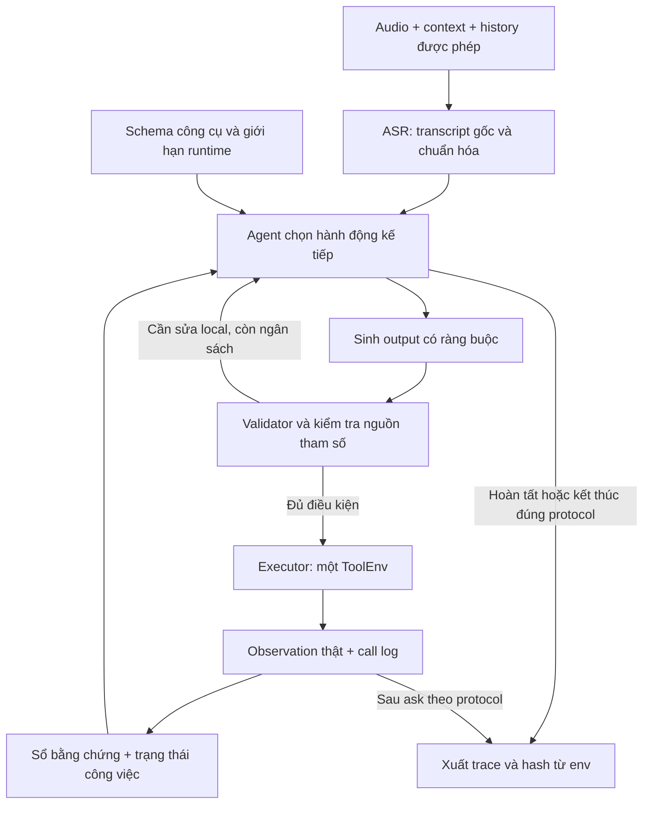

# LifeMate — Review v3 và chiến lược nâng cấp hướng thứ hạng cao

Ngày phân tích: **02/11/2026**, múi giờ GMT+7. Đối tượng: đội 3 người.

Tài liệu được review: `C:\Users\Lenovo\Downloads\LifeMate_Review_Plan_Team3.md`, phiên bản v2 ngày 01/11/2026. Đây là **bản phân tích mới**, không thay thế hoặc chỉnh sửa file đầu vào. Các đầu việc trong tài liệu đầu vào được xem là nội dung để đánh giá, không phải yêu cầu tự triển khai hệ thống.

## 1. Kết luận và lựa chọn đề xuất

**Bản v2 có nền tảng tốt để tạo một bài thi hợp lệ, có thể kiểm chứng. Muốn cạnh tranh thứ hạng cao, đội cần thêm cơ chế chọn đúng lỗi để sửa và xử lý tốt các trường hợp dễ làm mất toàn bộ điểm mẫu.** Chưa có code, dữ liệu, benchmark hoặc thông tin GPU của đội trong phiên review này; vì vậy không có cơ sở dự đoán top 1, top 3 hay mức tăng điểm cụ thể.

Nên giữ kiến trúc **ASR → Agent tuần tự → validator → ToolEnv**. Đề xuất phát triển thành hệ thống trong đó LLM hiểu yêu cầu và chọn bước tiếp theo, còn các phần xác định được bằng dữ liệu — nguồn ID, chuẩn hóa giá trị, phụ thuộc giữa hành động, kiểm tra schema và dừng — được kiểm soát bằng code.

Ba hướng đã cân nhắc:

| Hướng | Điểm mạnh | Đánh đổi | Khuyến nghị của bản review |
|---|---|---|---|
| Giữ prompting baseline, sửa pipeline và prompt | Nhanh, ít rủi ro tích hợp | Có thể sớm chạm giới hạn ở tham chiếu và chuỗi dài | Bắt buộc làm nền và giữ làm bản dự phòng |
| Bổ sung sổ bằng chứng, kiểm soát sinh tool call, xử lý ASR có chọn lọc; SFT nếu có bằng chứng cần | Có thể giảm lỗi đặc thù mà không tăng mạnh kích thước model | Cần đo từng thành phần và kiểm soát độ phức tạp | **Hướng ưu tiên** cho đội 3 người |
| Ensemble nhiều model, nhiều agent, search nhiều nhánh hoặc RL diện rộng | Có thêm khả năng khám phá lời giải | Tốn tham số, thời gian, dữ liệu và khó xử lý state | Chưa đưa vào kế hoạch chính |

Đây là lựa chọn tư vấn, chưa phải quyết định mà đội đã xác nhận. Nếu chỉ đủ nguồn lực cho ba thay đổi: **đo điểm mất theo nguyên nhân → sổ bằng chứng/tham chiếu → sinh output có ràng buộc**. Nếu đo được ASR là nút thắt lớn nhất, đưa ASR lên trước hai hạng mục sau.

## 2. Phạm vi xác minh và cập nhật quan trọng

Đã đọc toàn bộ file v2 và truy cập trực tiếp các tab Description, Evaluation, Rule, Submission Guidance của trang LifeMate. Tab Data yêu cầu đăng nhập; chưa tải hoặc chạy kit/evaluator. Chưa kiểm tra repo, checkpoint hay khả năng thực thi của đội.

### 2.1. Các thông tin nay đã đối chiếu được

| Hạng mục | Nội dung xác nhận |
|---|---|
| Tham số | Tổng hệ thống **<6B**; LLM **<5B** |
| Context | Tối đa **16.384 token** |
| Thực thi | **30 giây/mẫu**, offline; A30, CPU 16 lõi, RAM 64 GB |
| Dữ liệu/model | Công khai trước **26/10/2026**, license phù hợp |
| State | Cấm đọc/copy/parse cả thư mục `<split>_environment/`; một ToolEnv/mẫu; ghi đủ call |
| Synthetic | Được tạo lúc phát triển; dịch vụ/model sinh không dùng ở inference |
| Test | Cấm gán nhãn public/private để train hoặc tune |
| Tái lập | Seed cố định, decoding xác định; lệch kết quả: BTC chạy 5 lần, lấy trung bình |
| Đồng điểm | F1 bỏ kiểm tra hash, rồi latency trung bình |
| Nộp | Public: 5 lần/ngày; giải pháp: 2 lần, xét lần cuối |
| Hạn giải pháp | **16/11/2026, 23:59 GMT+7** |
| Private | **20/11, 09:00 → 23/11, 23:59 GMT+7** |

Nguồn: [LifeMate — Rule và Submission Guidance](https://challenge.zalo.ai/portal/lifemate), truy cập 02/11/2026. Đội vẫn cần lưu phiên bản quy định tại lúc nộp.

### 2.2. Những điều chưa được xác nhận bằng thực nghiệm

- Số lượng và phân phối mẫu, chất lượng transcript, cấu trúc history, danh sách tool và schema đầy đủ.
- Chi tiết implementation của matching, tokenizer cho fuzzy fields, serialization và hash; cách ghi call thất bại; API lấy trace và hành vi kết thúc.
- Cách tính thời gian khởi tạo/warm-up; entrypoint chính xác; cơ chế timeout, exception và phục hồi mà kit hỗ trợ.
- Cách BTC đếm tham số ở các trường hợp adapter, model dùng chung trọng số, MoE hoặc nhiều checkpoint thay phiên. Không tự dùng cách diễn giải có lợi nhất.
- Mức điểm, latency và VRAM của bất kỳ cấu hình nào trong báo cáo này.

Do đó: có thể chốt hướng kiến trúc và ưu tiên công việc, nhưng chưa chốt model thắng cuộc hoặc tuyên bố evaluator local tương đương tuyệt đối với BTC.

## 3. Review bản v2: giữ gì, sửa gì, bổ sung gì?

| Phần của v2 | Nhận xét | Thay đổi đề nghị ở v3 | Mức |
|---|---|---|---|
| §2.1 — trạng thái xác minh | Nhiều giới hạn còn ghi tạm thời | Cập nhật theo §2 bản này; phân biệt đã đọc luật với đã chạy kit | P0 |
| §3.1 — metric có điều kiện | Phân tích F1 hợp lý | Công thức trang chính thức đã đọc được; vẫn đối chiếu implementation bằng fixture | P0 |
| §4.1 — vòng lặp tuần tự | Hướng đúng | Giữ; thêm sổ bằng chứng và trạng thái việc cần làm | P0/P1 |
| §4.2 — grounding/cache | Đã nêu đúng nguyên tắc | Chuyển thành cấu trúc dữ liệu và quy tắc invalidation có thể kiểm thử | P1 |
| §4.3 — ngân sách 5/16/2/7 giây | Hữu ích để bắt đầu, chưa phản ánh từng mẫu | Đo theo audio, history và số bước; cấp thêm xử lý chỉ cho ca đáng giá | P1 |
| §5.1 — split | Đã chống leakage tương đối tốt | Thêm phân tích gần trùng, số group hiệu dụng và khoảng bất định | P0 |
| §5.2–5.3 — benchmark/taxonomy | Có đủ nhóm chỉ số | Bổ sung “điểm mất có thể phục hồi” để chọn experiment | P0 |
| §5.4 — SFT | Đúng khi đặt điều kiện | Tập trung lỗi có bằng chứng; thêm dữ liệu nhiễu giống ASR và ca đối chiếu | P2 |
| §6 — đội 3 người | Vai trò hợp lý; A vẫn là điểm nghẽn | B nhận báo cáo lỗi/benchmark harness phần ASR; C nhận structured output; A giữ executor/release | P0 |
| §7 — lịch | Có đệm trước hạn | Giới hạn số experiment đồng thời; thêm mốc cắt bỏ ý tưởng không đủ chứng cứ | P0 |
| §8 và §10 — checklist | Bao quát nhưng lặp nhiều | Khi triển khai, gom thành một checklist release có owner, run ID và bằng chứng | P1 |

**Điểm cần nói rõ:** validator, kiểm tra ID, cache trong mẫu, giới hạn retry, benchmark transcript chuẩn và chống leakage đã có trong v2. Bản v3 không xem chúng là ý tưởng mới; phần nâng cấp là làm chúng cụ thể, đo được và dùng được trong quyết định chọn giải pháp.

P0: phải có để đo đúng/chạy hợp lệ. P1: ưu tiên cải thiện sau baseline. P2: chỉ thử khi còn thời gian và có lỗi mục tiêu.

## 4. Tối ưu điểm theo bản chất bài thi

### 4.1. Điểm tổng phải là tiêu chí cuối

Với gold không rỗng, đặt `K = M + U`: khi hash đúng và `M > 0`, `s = 2M/(K+G)`; ngược lại `s = 0`. Điểm tổng là `100 × mean(s)`. Gold rỗng có nhánh riêng. Fuzzy dùng token-F1 **>0,6** sau lowercase/NFC. [Nguồn: Evaluation](https://challenge.zalo.ai/portal/lifemate).

Giữ fixture riêng cho gold rỗng, call trùng, call lỗi và nhiều ứng viên fuzzy; không suy diễn implementation từ công thức rút gọn. Không dùng việc fuzzy ít ảnh hưởng state để bỏ qua chất lượng nội dung.

Ví dụ minh họa, **không phải kết quả benchmark**:

- Trên 500 mẫu, sửa 10 mẫu từ 0 lên 0,9 mang lại **+1,8 điểm trên thang 100**.
- Cũng trên 500 mẫu, bỏ một call thừa ở 20 mẫu có ba gold call và ba call khớp làm mỗi mẫu tăng từ 6/7 lên 1: tổng tăng khoảng **+0,57 điểm**.
- Vì vậy, nhóm lỗi gây sai state có thể đáng ưu tiên hơn việc làm trace đẹp; nhưng phải dùng số liệu thật về tần suất và mức sửa được.

### 4.2. Xếp hạng công việc bằng điểm mất

Sau baseline, lập một bảng duy nhất:

| Nhóm nguyên nhân đầu tiên | Số mẫu | Tổng điểm mất `Σ(1−s)` | Hướng sửa | Chi phí dự kiến | Kết quả trước/sau |
|---|---:|---:|---|---:|---|
| Nhầm tên/số/phủ định từ ASR | Chưa đo | Chưa đo | ASR, giữ bất định, slot checks | Chưa ước lượng | Chưa chạy |
| Sai thực thể hoặc tham chiếu history | Chưa đo | Chưa đo | Evidence ledger, resolver | Chưa ước lượng | Chưa chạy |
| Thiếu bước hoặc lặp write | Chưa đo | Chưa đo | Task state, dependency tracking | Chưa ước lượng | Chưa chạy |
| Hỏi thiếu sai hoặc OOS sai | Chưa đo | Chưa đo | Ca đối chiếu, policy, SFT có mục tiêu | Chưa ước lượng | Chưa chạy |
| JSON/schema, timeout, đóng gói | Chưa đo | Chưa đo | Decoder, runtime, release | Chưa ước lượng | Chưa chạy |

Mỗi mẫu có một nguyên nhân gốc để cộng điểm mất; các lỗi hậu quả là nhãn phụ. Có thể xếp ưu tiên bằng `điểm mất × tỷ lệ dự kiến cứu được / giờ-người`, nhưng tỷ lệ dự kiến chỉ là giả thuyết ban đầu. Thay bằng kết quả đo theo cặp sau experiment; không cộng mức tăng của các module như thể chúng độc lập.

Nếu dùng transcript chuẩn hoặc sửa tay một tham số để chẩn đoán, ghi đây là **can thiệp phân tích offline**. Nó không chứng minh hệ thống inference có thể tự tìm được đáp án đó và không được đưa vào đường chạy thi.

## 5. Kiến trúc nâng cấp đề xuất

Sơ đồ là thiết kế đề xuất, không mô tả code đã tồn tại. Runner kiểm soát deadline, exception và serialization xuyên suốt. Mọi đường kết thúc phải theo API thật của kit; không tạo “stop tool” tự chế trong submission.

### 5.1. P1 — Sổ bằng chứng và phân giải thực thể

**Vấn đề:** đúng tool nhưng nhầm người, nhầm thiết bị, dùng ID hết hiệu lực hoặc quên kết quả bước trước có thể phá kết quả cả mẫu.

Mở rộng ý grounding ở v2 thành một bảng trong bộ nhớ, phạm vi đúng một mẫu:

| Trường nội bộ | Ý nghĩa |
|---|---|
| `entity_type`, `canonical_id` | Loại và ID gốc, không viết lại/chuẩn hóa ID |
| `attributes` | Thuộc tính nhận từ nguồn được phép, phân biệt thiếu với giá trị rỗng |
| `source_kind`, `source_ref`, `observed_step` | Context/history/tool result nào cung cấp bằng chứng |
| `validity` | `current`, `stale` hoặc `unknown`; không mặc định còn đúng sau write |
| `request_span` | Đoạn yêu cầu liên quan, để đối chiếu lựa chọn |

Quy trình resolver: ưu tiên ID hợp lệ có sẵn → lọc ứng viên bằng thuộc tính rõ ràng → giải tham chiếu từ history có nguồn → nếu còn thiếu, chọn read hữu ích hoặc ask đúng quy ước. Không chọn kết quả đầu tiên chỉ vì tool trả danh sách theo thứ tự đó.

Sau write, đánh dấu stale theo nhóm dữ liệu chịu tác động; nếu chưa biết tác động chính xác, invalidation rộng hơn trong module đó. Sổ này **không phải bản sao state ẩn** và không truy cập trực tiếp thư mục môi trường.

**Đo:** tỷ lệ chọn đúng thực thể trên lát cắt có nhãn, sai hash do grounding, call read thừa và điểm end-to-end. Giữ khi giảm lỗi thực thể mà không làm mất read cần thiết.

### 5.2. P1 — Sinh JSON/tool call có ràng buộc

**Vấn đề:** vòng “sinh sai → validator → sửa lại” tốn thời gian và vẫn có thể thất bại. Có thể chặn một phần lỗi ngay lúc decoding bằng JSON schema/grammar nếu runtime hỗ trợ. vLLM có structured outputs; mức hỗ trợ phụ thuộc backend và phiên bản. [Tài liệu vLLM](https://docs.vllm.ai/en/latest/features/structured_outputs/).

Đề xuất:

1. Sinh một action mỗi lượt, với tên tool thuộc catalog hợp lệ và cấu trúc arguments tương ứng.
2. Kiểm thử riêng template tool calling của checkpoint và runtime trước khi bật toàn bộ schema.
3. Validator vẫn kiểm tra schema đầy đủ, custom extensions, nguồn ID và logic nghiệp vụ. JSON hợp lệ không đồng nghĩa đúng ý người dùng.
4. Tín hiệu kết thúc nội bộ tách khỏi tool call; không ép model gọi tool chỉ vì grammar không có đường dừng.
5. Compile/cache grammar theo schema/config trong phạm vi runtime cho phép; đo cả chi phí compile lần đầu.

**Rủi ro:** backend không hỗ trợ đủ schema; grammar vô tình bỏ nhánh hợp lệ; output bị ràng buộc đúng cú pháp nhưng sai ngữ nghĩa. Không tự xem `x-ref`, `x-one-of` là JSON Schema chuẩn; phải đọc ý nghĩa trong kit. Giữ đường baseline nếu tính năng không tương thích.

**Đo:** lỗi schema, số lượt sửa, latency và điểm end-to-end. Nếu baseline gần như không lỗi format, ưu tiên hạng mục khác trước.

### 5.3. P1/P2 — ASR tập trung vào thông tin quyết định hành động

**Vấn đề:** WER tốt hơn không bảo đảm tốt hơn ở số tiền, số điện thoại, thời gian, phủ định và tên riêng. Chọn ASR dựa trên điểm end-to-end cùng lỗi của các trường này.

Hai mức triển khai:

- **Mức nhẹ:** giữ raw transcript và normalized transcript; chuẩn hóa số/ngày khi ý nghĩa rõ; lưu dấu vết biến đổi. Giá trị như số điện thoại phải giữ số 0 đầu và kiểu dữ liệu theo schema. “Chiều mai” lấy thời gian của mẫu. Câu chưa rõ không bị ép thành một cách hiểu chắc chắn.
- **Mức nâng cao:** chỉ với ca có tín hiệu khó, giải mã lại đoạn audio đủ ngữ cảnh hoặc dùng một giả thuyết khác nếu ASR hỗ trợ. Ưu tiên dùng lại cùng checkpoint; thêm ASR thứ hai phải tính cả tham số và runtime.

Tín hiệu kích hoạt có thể là bất đồng tên/số giữa các giả thuyết, độ tin cậy thực sự do ASR cung cấp, hoặc giá trị quan trọng không thể gắn với bằng chứng hiện có. Không dùng “LLM tự nói chắc chắn” làm xác suất đúng đã hiệu chuẩn. Nếu không có timestamp tin cậy, không cắt một đoạn audio tùy ý.

Chọn giả thuyết từ audio, context và observation hợp lệ; **không** thử nhiều giả thuyết bằng cách thực thi nhiều chuỗi write rồi chọn hash/điểm tốt nhất. Không sửa transcript thành tên trong danh bạ chỉ vì tên đó tồn tại. Nếu bất định còn lại làm thay đổi hành động, xử lý theo policy ask của đề.

**Đo:** lỗi slot quan trọng, số ca được cứu/bị hỏng do xử lý lần hai, điểm chung và timeout. Chuẩn hóa vốn đã có trong v2; phần mới là đường xử lý có điều kiện và phép đo lợi ích thực của nó.

### 5.4. P1 — Theo dõi phụ thuộc và tiến độ công việc

Với yêu cầu nhiều việc, duy trì danh sách nhỏ: `pending`, `blocked`, `done`; mỗi việc có điều kiện đầu vào và bằng chứng hoàn thành. Đây là trạng thái điều phối, không yêu cầu model xuất suy luận dài hoặc một kế hoạch cố định phải thi hành bằng mọi giá.

Ví dụ giả định: “Tắt đèn phòng khách rồi đặt xe về nhà”. Bước đặt xe chỉ thực hiện sau bước trước nếu từ “rồi” thể hiện ràng buộc thứ tự; địa chỉ phải lấy từ nguồn được phép. Nếu một tham số thiếu, không tự mặc định bỏ cả các việc độc lập: làm theo policy được xác nhận từ kit/train.

Sau mỗi observation: cập nhật việc hoàn tất → giải các phụ thuộc mới → chọn đúng một hành động tiếp theo. Phân biệt hành động giống nhau do model lặp với hai hành động giống nhau được người dùng yêu cầu thật; không cấm tất cả call trùng bằng một quy tắc thô.

**Đo:** thiếu bước, write lặp, sai thứ tự, dừng quá sớm và số lượt LLM. Nếu trạng thái công việc chỉ lặp lại thông tin sẵn có mà tăng độ trễ, thu nhỏ hoặc bỏ.

### 5.5. P2 — Thêm một lượt kiểm tra chỉ ở ca khó

Chỉ cân nhắc sau khi đường chạy đơn đã ổn định. Dùng cùng model kiểm tra proposal và bằng chứng trước write ở các ca còn bất đồng; không gọi model lần hai cho mọi bước.

Lượt kiểm tra trả cấu trúc ngắn như “hợp lệ / thiếu bằng chứng / tham số mâu thuẫn”, không được tự tạo nguồn dữ liệu. Chỉ bật khi còn đủ ngân sách cho hành động và serialization. Đây không phải một người chấm độc lập; cùng model có thể lặp lại cùng sai lầm.

**Đo theo ablation:** không kiểm tra / kiểm tra mọi write / kiểm tra có điều kiện. Giữ phương án có điểm và runtime tốt hơn; bỏ nếu tăng timeout hoặc chỉ đổi văn phong. Không để kiểm tra biến thành hỏi xác nhận mọi write.

## 6. Dữ liệu và SFT: học đúng phần hệ thống còn yếu

Không mặc định phải fine-tune để đạt top. Chỉ mở SFT khi baseline đã ổn định, còn lỗi hành vi lặp lại và đội đủ thời gian chạy so sánh trên cùng dev.

### 6.1. Bốn nhóm dữ liệu nên ưu tiên

| Nhóm | Mục tiêu | Cách tạo từ training portion |
|---|---|---|
| Nhầm thực thể gần nhau | Chọn đúng người/thiết bị nhờ thuộc tính hoặc history | Các ca nhiều tên gần giống; target giữ ID và nguồn đúng |
| Cặp thay đổi nhỏ nhưng đổi hành động | Học phủ định, đổi người nhận, khác số, thiếu một tham số | Biến thể hợp lệ; xác minh lại nhãn và trajectory |
| Transcript lỗi giống ASR | Agent bền hơn với đầu vào thực | Chạy ASR baseline trên audio train; chỉ dùng target còn suy ra được từ đầu vào |
| Ask/OOS và dừng | Giảm thực thi quá mức hoặc hỏi thiếu không cần thiết | Cặp đủ/thiếu thông tin và có/không có app phù hợp |

Không bắt model đoán số đúng từ gold khi audio/transcript đã mất thông tin quyết định. Với mẫu nhiễu như vậy, giữ nguồn audio bổ sung nếu thiết kế dùng được hoặc loại khỏi tập SFT next-action không còn nhãn xác định.

Các hành động sai dùng làm ca đối chiếu hoặc dữ liệu đánh giá; không đưa một write sai làm positive target. SFT từng bước chỉ thấy prefix hợp lệ tại bước đó, không thấy future observations, gold hash hoặc lời giải tương lai.

### 6.2. Dữ liệu sinh và ví dụ few-shot

- Khởi đầu bằng tập nhỏ có thể rà thủ công; giữ tỷ lệ theo nhóm lỗi, không tạo hàng loạt biến thể chỉ đổi tên.
- Tách train/dev/holdout trước khi sinh; toàn bộ họ biến thể ở cùng một split.
- Nếu dùng teacher/TTS trong phát triển, lưu nguồn, cấu hình và lineage; giải pháp inference chỉ chứa thành phần hợp lệ đã chốt.
- Few-shot lấy từ train, lựa chọn theo mẫu tool/dependency. Không lấy câu gần giống từ dev rồi chép đáp án vào prompt. Nếu xây retrieval, bắt đầu với cách đơn giản không thêm model và đo chi phí prompt.
- ID trong ví dụ không được dùng như bằng chứng cho mẫu hiện tại. Demo placeholders cần biểu diễn đúng để model không sao chép thành ID thật.
- Mặc định giữ checkpoint đã đánh giá. Retrain trên dữ liệu rộng hơn là ứng viên mới, phải có phương án kiểm chứng riêng.

Điều kiện giữ adapter: điểm end-to-end cải thiện đủ thuyết phục trên dev, không suy giảm đáng kể các lát cắt quan trọng, đạt tài nguyên và tái lập. Train loss giảm không đủ.

## 7. Model và runtime: phân bổ tài nguyên theo nút thắt

Không chốt tên checkpoint từ trí nhớ hay benchmark chung; chưa có phép đo nào chứng minh model cụ thể tốt nhất cho đội. B sàng lọc tối đa hai ASR, C tối đa hai LLM hợp lệ; ưu tiên kiểm tra gold-text Agent trước khi chạy toàn bộ tổ hợp.

### 7.1. Ngân sách tham số

Lập manifest cho mọi thành phần learned ở inference: checkpoint/revision, số tham số thực, license, ngày phát hành, adapter, nhiệm vụ và runtime. Không quên model nhỏ dùng làm router, reranker hay verifier. Quantization giảm dung lượng bộ nhớ, không làm số tham số của model giảm theo cùng tỷ lệ.

Ví dụ số học **giả định**, không phải shortlist: LLM 4,0B + ASR 1,4B = 5,4B trước khi tính các thành phần khác. Một model gắn nhãn thương mại “5B” không được mặc định hợp lệ; dùng số thực và cách đếm BTC xác nhận. Không thiết kế sát trần khi còn chưa rõ cách cộng adapter/shared weights.

### 7.2. Ngân sách thời gian động

Giữ một deadline monotonic ở runner. Trước mỗi lượt LLM hoặc giải mã ASR bổ sung, kiểm tra thời gian còn lại so với chi phí dự kiến và phần dành cho xuất kết quả. Thiết lập timeout có khả năng hủy thật; không chỉ kiểm tra sau khi tác vụ đã chạy xong.

Theo dõi riêng: load/warm-up, ASR, prefill, decode, tool execution, validator, serialization. Đo cả lần đầu và những lần tiếp theo để biết điều kiện nào tương ứng quy trình chấm. Số liệu trên GPU khác không chứng minh đạt máy chấm.

Tối ưu theo thứ tự đề xuất:

1. Bỏ prompt lặp và observation không còn cần thiết, giữ nguyên giá trị canonical và bằng chứng đang dùng.
2. Giới hạn output; chọn chat template đúng. Tổng token phải tính cả schema, history, observation và phần sinh tiếp theo.
3. Giảm lượt model không có ích; dùng cache prefix chỉ khi runtime hỗ trợ đúng và kiểm chứng không trộn dữ liệu giữa mẫu.
4. Thử runtime/quantization trên hardware phù hợp; đo lại cả chất lượng và bộ nhớ, không mặc định kernel mới nhanh hơn.
5. Chỉ bật ASR lần hai/verifier cho các ca có lợi ích đo được.

Latency trung bình phục vụ so sánh hiệu quả; p95, max và tỷ lệ timeout phục vụ kiểm tra khả năng hoàn tất. Không hy sinh nhiều điểm chính chỉ để giảm thời gian trung bình. Không dùng `[]` hoặc ask giả để che lỗi timeout.

## 8. Kế hoạch experiment và quyết định giữ/bỏ

### 8.1. Quy trình chung

Mỗi experiment phải có: giả thuyết → lát cắt lỗi mục tiêu → một thay đổi chính → so theo cặp trên cùng dev → kiểm tra regression → quyết định. Có thể sàng lọc trên subset cố định, nhưng ứng viên cuối phải chạy toàn dev với runtime nộp bài.

| ID | So sánh | Owner | Ưu tiên | Điều kiện mở |
|---|---|---|---|---|
| E0 | Baseline end-to-end, ASR, gold-text Agent | A/B/C | P0 | Kit và evaluator dùng được |
| E1 | Baseline + ledger/resolver | A/C | P1 | Có lỗi grounding/tham chiếu |
| E2 | Baseline tốt nhất + constrained decoding | C | P1 | Runtime hỗ trợ, lỗi format đáng kể |
| E3 | Giữ raw + normalization có dấu vết | B | P1 | Có lỗi slot hoặc normalization |
| E4 | Xử lý ASR lần hai có điều kiện | B/C | P2 | ASR là nút thắt, còn thời gian/memory |
| E5 | Task state/phụ thuộc | C/A | P1 | Multi-step bỏ sót hoặc lặp là lỗi lớn |
| E6 | SFT có mục tiêu | C, B chuẩn bị dữ liệu | P2 | E0 ổn định, đủ dữ liệu sạch và compute |
| E7 | Verifier có điều kiện | C | P2 | Lỗi write còn lớn, còn ngân sách |
| E8 | Runtime/quantization/prompt ngắn | A/C | P1 | Profiling xác định nút thắt |

Không chạy tất cả chỉ vì có tên trong bảng. Sau E0, chọn tối đa hai experiment chất lượng ưu tiên cao nhất; các experiment khác chờ kết quả. Khi ghép hai cải tiến, đo lại vì lợi ích có thể trùng nhau hoặc tương tác xấu.

### 8.2. Báo cáo tối thiểu

`run_id`, commit, split hash, model/prompt/config hash, trạng thái hợp lệ, điểm end-to-end, hash-match, call F1, ask/OOS, số ca được cứu/thoái lui, mean/p95/max latency, timeout, peak VRAM, dữ liệu/compute đã dùng.

Quy tắc chọn ứng viên:

1. Loại cấu hình không hợp lệ hoặc không hoàn tất bài đo đầy đủ; báo cả số mẫu lỗi, không âm thầm loại chúng khỏi mẫu số.
2. So điểm tổng và lỗi theo cặp. Nếu group liên quan, bootstrap theo group để mô tả độ bất định; không coi từng dòng là độc lập.
3. Kiểm tra lát cắt hiếm; một mức tăng trung bình nhỏ không đủ nếu một nhóm quan trọng bị phá và nhóm đó có ít dữ liệu.
4. Đăng ký trước số experiment và tiêu chí dừng ở mức thực tế. Khoảng tin cậy sau nhiều lần tune dev không phải bằng chứng độc lập tuyệt đối.
5. Khi bằng chứng chưa rõ, giữ bản đơn giản, ổn định hơn. Chạy lặp dùng để đo tính tái lập, không tạo thêm dữ liệu validation độc lập.
6. Chốt ứng viên bằng dev rồi mới mở holdout. Nếu sửa theo holdout, ghi rõ holdout đó đã tham gia lựa chọn.

## 9. Phân công và lịch thực thi đề nghị

### 9.1. Vai trò và bàn giao

| Người | Trách nhiệm | Đầu ra phải có | Người chạy lại |
|---|---|---|---|
| A | Rules/kit, split, evaluator, executor, deadline, release | Baseline chạy thật; báo cáo điểm; container và checksum | B |
| B | Audio/ASR, lỗi slot, regression/data lineage, tổng hợp lỗi | Bảng lỗi ASR và điểm mất; module ASR; manifest dữ liệu | C |
| C | Agent, ledger phía policy, structured output, task state, SFT nếu cần | Config/checkpoint; ablation Agent; tài liệu tái hiện | A |

Hợp đồng API của v2 tiếp tục dùng. Mỗi bàn giao có đường dẫn trong repo, lệnh chạy, run ID và đầu ra mong đợi; A không phải tự đoán cách chạy module của B/C. B giữ vai trò dự phòng chạy release.

### 9.2. Lịch cập nhật từ 02/11

| Ngày | Trọng tâm | Cổng quyết định |
|---|---|---|
| 02–03/11 | Đối chiếu kit, split, evaluator; một ASR + một Agent; container sơ bộ | Có E0 thật, đủ ID và log lỗi; nếu chưa có thì dừng mở model mới |
| 04–05/11 | Đo điểm mất; shortlist nhỏ; sửa lỗi pipeline/schema/grounding | Chọn tối đa hai hướng có khả năng cải thiện lớn nhất |
| 06–08/11 | Thực hiện và đo các hướng đã chọn; SFT nhỏ chỉ khi đủ điều kiện | Kết thúc 08/11: bỏ experiment chưa có tín hiệu, không chuyển sang RL để “gỡ” |
| 09–10/11 | Ghép cải tiến có ích; kiểm thử runtime, audio dài, history dài | Chốt ứng viên chất lượng; hạn chế thêm thành phần mới |
| 11–12/11 | Full dev, kiểm tra hồi quy, đóng gói sạch | Không còn lỗi format/thiếu artifact; tài nguyên được đo |
| 13/11 | Khóa ứng viên, holdout một lần; người khác chạy lại | Báo cáo chất lượng cuối, ghi rõ mọi hạn chế |
| 14/11 | Đóng băng nội bộ, checksum và tài liệu | Bản release tái hiện được |
| 15–16/11 | Nộp sớm, xác minh trạng thái tiếp nhận | Chỉ sửa blocker; sửa gì cũng chạy lại kiểm tra liên quan |
| 20–23/11 | Chạy private theo hướng dẫn bằng bản đã đóng băng | Không tune theo private |

Lịch kế thừa các mốc của v2; hạn chính thức đã đối chiếu ở §2.1. Không dùng ngày trong lịch thay cho bằng chứng nghiệm thu.

### 9.3. Điều chỉnh theo năng lực thực tế

Với giả định 156–234 giờ-người của v2, chỉ cam kết khoảng 75% cho việc dự kiến. Ước lượng khởi đầu cho phần lõi: xác minh/contract 10 giờ; runner/evaluation 16; ASR 18; Agent 18; lỗi/ablation 12; profiling 10; release 20 — tổng **104 giờ-người**. Đây là ước lượng để đội hiệu chỉnh sau hai ngày đầu, không phải định mức đã đo; GPU-hours phải lập riêng.

- Nếu nguồn lực thấp: giữ baseline, evaluator, ledger tối thiểu, sửa hai lỗi lớn nhất và release; bỏ E4/E6/E7.
- Nếu còn dư: chỉ mở một hạng mục nâng cao sau khi hoàn tất full dev, không dùng hết khoảng đệm để train.
- Nếu chỉ còn bảy ngày: hai ngày baseline, hai ngày sửa lỗi, một ngày đo, hai ngày đóng gói/đệm.

## 10. Những ý tưởng nên tránh ở giai đoạn này

| Ý tưởng | Lý do chưa ưu tiên | Khi nào xem xét lại |
|---|---|---|
| Thêm nhiều agent hoặc model chuyên gia | Tăng độ trễ, tham số và điểm lỗi tích hợp | Có ablation cho thấy một năng lực cụ thể không giải bằng cách nhẹ hơn |
| RL/GRPO toàn bộ policy | Reward và rollout state phức tạp, khó kịp kiểm chứng | Có evaluator ổn định, compute và thời gian ngoài đường găng |
| RAG tri thức chung quy mô lớn | Nút thắt hiện chưa được chứng minh là thiếu tri thức ngoài | Có nhóm lỗi kiến thức được phép bổ sung và đo được |
| Hard-code ID/kịch bản theo mẫu train | Dễ overfit, không phải grounding mẫu mới | Chỉ dùng quy tắc tổng quát từ schema/ngữ nghĩa đã xác minh |
| Tối ưu token fuzzy để “ăn ngưỡng” | Có thể làm nội dung sai và không tổng quát | Không chọn làm chiến lược; sửa đúng nội dung yêu cầu |
| ASR kép và verifier cho mọi mẫu | Tốn compute kể cả mẫu dễ | Chỉ giữ nếu lợi ích end-to-end vượt chi phí thật |
| Làm giao diện/demo đẹp trước | Chưa có bằng chứng ảnh hưởng metric kỹ thuật | Làm sau bản thi ổn định, nếu vòng trình bày cần |

## 11. Checklist quyết định trước khi nộp

- [ ] Đã đối chiếu lại quy định hiện hành và lưu bản/version nguồn.
- [ ] Kit, schema, matching, call lỗi và hash được kiểm thử; phân biệt metric thật với proxy.
- [ ] Tổng tham số, context và mọi component inference được kê đầy đủ; license/cutoff có bằng chứng.
- [ ] Split/lineage hợp lệ; không đưa đáp án dev/holdout/test vào prompt, SFT hoặc luật theo ID.
- [ ] Có baseline dự phòng và bảng ablation giải thích từng thành phần được giữ.
- [ ] Đo cả điểm mất, điểm thu hồi, regression, timeout và peak VRAM trên pipeline thật.
- [ ] Kiểm tra tên trùng, số 0 đầu, phủ định, ngày qua tháng/năm, history tham chiếu, nhiều hành động, ask/OOS, call thất bại và dữ liệu giống mệnh lệnh trong tool result.
- [ ] Không truy cập state trực tiếp; mỗi lần inference dùng đúng vòng đời env; mọi call thật được ghi đủ.
- [ ] Không giả hash/trace, không retry write mù và không dùng gold để chọn nhánh inference.
- [ ] Container sạch chạy offline, đủ model/tokenizer/dependency; đúng entrypoint/output của kit.
- [ ] B hoặc thành viên không build trực tiếp đã chạy lại release; lưu checksum và version cuối.
- [ ] Nộp sớm; xác nhận bản cuối được nhận, không chỉ xác nhận upload thành công.

## 12. Việc nên làm ngay và tiêu chí “sẵn sàng cạnh tranh”

Trong buổi làm đầu: A lấy kit/evaluator và chạy một mẫu thật; B đo ASR trên tập nhỏ đa dạng từ train/dev đúng mục đích; C chạy Agent với transcript chuẩn. Sau đó nối E0, xuất bảng điểm mất và chọn hai hướng sửa. Đây là bước tạo căn cứ cho chiến lược top, trước khi đầu tư training.

Chỉ gọi giải pháp “sẵn sàng cạnh tranh” khi đội có: baseline tái hiện được, cải tiến thắng qua ablation, chất lượng không chỉ tập trung vào vài template, runtime đã kiểm chứng và bài nộp hợp lệ. **Thứ hạng vẫn phụ thuộc private test và đối thủ; tài liệu này là lộ trình tăng sức cạnh tranh, không phải cam kết đạt top.**

## 13. Nguồn và dấu vết review

- **Đầu vào chính:** `LifeMate_Review_Plan_Team3.md`, v2 ngày 01/11/2026, đọc toàn bộ. Không có tài liệu “Tài Liệu Phân Tích Đề Bài & Chiến Lược LifeMate.md” mà v2 nhắc tới trong đầu vào phiên này.
- **Cuộc thi:** [LifeMate — trang chính thức](https://challenge.zalo.ai/portal/lifemate), đọc các tab công khai ngày 02/11/2026; Data yêu cầu đăng nhập. Nguồn dùng để đối chiếu luật, không thay thế việc chạy kit.
- **Kỹ thuật tham khảo:** [vLLM Structured Outputs](https://docs.vllm.ai/en/latest/features/structured_outputs/), truy cập 02/11/2026. Đây là tài liệu tính năng; không phải bằng chứng tăng điểm LifeMate. Khi triển khai phải pin phiên bản, không phụ thuộc URL `latest` để tái hiện.
- **Các kiến trúc, ưu tiên, ước lượng và ví dụ số trong báo cáo:** đề xuất/phân tích của lần review này, chưa được benchmark.
- **SHA-256 file đầu vào trước khi tạo bản mới:** `33FCDFAE6F057BC254ECD6905FE59BA8BEAE6DF91E5313F49D716DA4C69094C2`.

