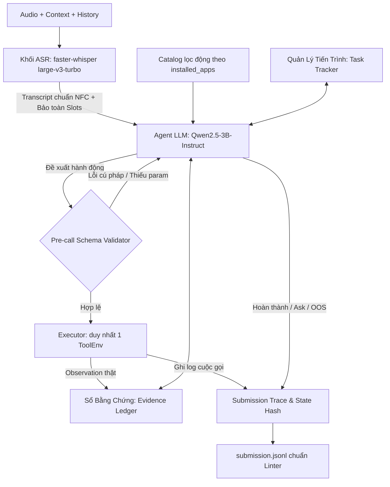

# MASTER PLAN — CHIẾN LƯỢC TỔNG THỂ & THI HÀNH LIFEMATE AGENT
## ZALO AI CHALLENGE 2026 — VOICE-DRIVEN AI AGENT
> **Tài liệu duy nhất có hiệu lực (Single Source of Truth).**  
> **Phiên bản:** v3.1 — Hợp nhất hoàn chỉnh từ Tài liệu phân tích đề bài (v1), Review Plan (v2) và Upgrade Strategy (v3).  
> **Áp dụng cho:** Toàn bộ thành viên Team 3 (Lead / Member A, Member B - ASR, Member C - Agent LLM).  
> **Múi giờ kế hoạch:** GMT+7. Hạn nộp Docker giải pháp: **16/11/2026, 23:59 GMT+7**.

---

## 1. Bản Chất Bài Toán & Mục Tiêu Tối Thượng (Executive Summary)

**LifeMate** yêu cầu xây dựng một **Voice-driven AI Agent** (Tác tử điều khiển bằng giọng nói) hoạt động hoàn toàn offline trên các thiết bị không màn hình hoặc màn hình nhỏ (loa thông minh, xe hơi, tai nghe, đồng hồ...). Hệ thống nhận đầu vào là câu lệnh tiếng Việt tự nhiên (có hiện tượng code-switching pha trộn từ tiếng Anh thông dụng như *"book"*, *"AC"*, *"wifi"*, *"check mail"*) và chuyển đổi thành **chuỗi hành động gọi công cụ (multi-step tool calls)** chính xác để thay đổi trạng thái của các ứng dụng theo đúng ý người dùng.

> **Triết lý cốt lõi của đề bài:**  
> *"The agent is judged on what it does, not what it says."*  
> Hệ thống được chấm điểm dựa trên **danh sách các lệnh gọi hàm đã thực thi (`tool_calls`)** và **trạng thái băm của ứng dụng sau thực thi (`state_hash`)**, hoàn toàn không chấm câu trả lời văn bản giao tiếp với người dùng.

### Ba kịch bản đầu ra mà Agent bắt buộc xử lý:
1. **Thực thi hành động (Execute — chiếm 78.8% tập Train):** Gọi chuỗi công cụ tuần tự (`read` $\rightarrow$ lấy ID $\rightarrow$ `write`) để đưa dữ liệu của các ứng dụng về đúng trạng thái cuối cùng người dùng mong muốn.
2. **Hỏi thêm thông tin bị thiếu (Ask missing info — chiếm 14.0% tập Train):** Khi yêu cầu của người dùng chưa đủ tham số bắt buộc và không thể tìm thấy trong hệ thống, gọi công cụ đặc biệt `sys.ask_missing_info` chỉ rõ `tool_name` dự định gọi và danh sách `params` còn thiếu. *(Có thể gọi sau một số lệnh `read` kiểm tra dữ liệu).*
3. **Từ chối / Ngoài phạm vi (Out-of-Scope / OOS — chiếm 7.2% tập Train):** Nếu yêu cầu thuộc về ứng dụng chưa được cài đặt trong thiết bị (`context.installed_apps`), **trả về mảng rỗng `[]` ngay lập tức** (được tính 1.0 điểm tuyệt đối).

---

## 2. Quy Định, Ràng Buộc Kỹ Thuật & Mốc Thời Gian (Hard Constraints)

Mọi giải pháp phải chạy **Offline 100%** trong Docker container trên cấu hình phần cứng cố định của Ban Tổ Chức:

| Hạng mục | Quy định giới hạn | Phân tích & Giải pháp kỹ thuật |
| :--- | :--- | :--- |
| **Tổng tham số hệ thống** | **< 6.0B parameters** | Tổng kích thước toàn bộ hệ thống (ASR 0.81B + LLM 4.02B = **4.83B** < 6.0B). |
| **Giới hạn LLM** | **< 5.0B parameters** | Dùng **Qwen3-4B-Instruct-2507** (4.02B params thực, bfloat16, Apache-2.0, non-thinking, native 256K). |
| **Context Window** | **$\le 16,384$ tokens** | Lọc tool động theo `installed_apps` (giảm token prompt xuống < 2,000 tokens). |
| **Phần cứng máy chấm** | **1x NVIDIA A30 (24GB VRAM)**<br>CPU 16-core Xeon Gold, 64GB RAM | Đủ nạp đồng thời 1 model ASR (~800M) và 1 model LLM (~3B) ở chuẩn FP16/BF16 không cần lượng tử hóa sâu. |
| **Thời gian chạy (Latency)** | **$\le 30.0$ giây / mẫu** | Quá 30s hoặc crash tính 0 điểm. Mục tiêu P95 nội bộ: **$\le 25.0$ giây/mẫu**. |
| **Tính tái lập (Reproducibility)**| Bắt buộc tái lập 100% | Cố định toàn bộ Random Seeds (`seed=42`), Greedy Decoding (`temperature=0.0`, `do_sample=False`). |
| **Dữ liệu & Model mã nguồn mở** | Phát hành trước **26/10/2026** | License hợp lệ, kiểm tra ngày phát hành và revision chính thức. |
| **Sinh dữ liệu nhân tạo (Synthetic)**| **Chỉ dùng lúc phát triển** | Nghiêm cấm dùng API/mô hình ngoài gán nhãn hay can thiệp trực tiếp lên `public_test` hoặc `private_test`. |
| **Tương tác môi trường** | **CẤM đọc trực tiếp `state.json`** | Mọi tương tác phải đi qua đúng 1 instance `ToolEnv` cho mỗi mẫu. Vi phạm = Loại trực tiếp. |
| **Tiêu chí phụ (Tie-breaking)** | 1. Điểm F1 bỏ qua `state_hash`<br>2. Thời gian xử lý trung bình thấp hơn | Tốc độ suy luận nhanh và gọi tool chuẩn xác giúp thắng khi bằng điểm. |

### Lộ trình thi đấu (Timeline):
* **Vòng 1 — Public Test (26/10 – 16/11):** Nộp file `.jsonl` lên cổng ZAC (tối đa 5 lần/ngày).
* **HẠN CHÓT NỘP DOCKER GIẢI PHÁP: 16/11/2026 lúc 23:59 GMT+7.**
* **Vòng 2 — Private Test (20/11 – 23/11):** Mở tập Private lúc 09:00 ngày 20/11; chạy bản Docker đã đóng băng và nộp kết quả trước 23:59 ngày 23/11.
* **Công bố kết quả chung cuộc:** Ngày **02/12/2026**.

---

## 3. Phân Tích Toán Học Hàm Đánh Giá & Các "Tử Huyệt"

### 3.1. Công thức tính điểm cho từng mẫu $i$ ($\text{Score}_i$)
* **Kịch bản Out-of-Scope (Nhãn chuẩn $|G| = 0$):**
  * Nộp danh sách rỗng (`[]`): $\text{Score}_i = 1.0$.
  * Nộp bất kỳ lệnh nào ($K > 0$): $\text{Score}_i = 0.0$.
* **Kịch bản có lệnh gọi (Nhãn chuẩn $|G| > 0$):**
  $$\text{Score}_i = \begin{cases} 0, & \text{nếu } \text{hash}_{\text{sys}} \neq \text{hash}_{\text{gold}} \text{ hoặc } M = 0 \\ \frac{2 \cdot P \cdot R}{P + R} = \frac{2M}{K + |G|}, & \text{ngược lại} \end{cases}$$
  * Trong đó:
    * $|G|$: Tổng số lệnh gọi trong nhãn chuẩn (Gold calls).
    * $K = M + U$: Tổng số lệnh gọi hệ thống sinh ra.
    * $M$: Số lệnh gọi của hệ thống **khớp (matched)** với nhãn chuẩn (ghép cặp 1-1, không xét thứ tự).
    * $U$: Số lệnh gọi **không khớp (unmatched)**, bao gồm cả các lệnh gọi bị lỗi schema hay trả về `"ok": false`.
    * $P = \frac{M}{M + U}$ (Precision), $R = \frac{M}{|G|}$ (Recall).
    * Điểm chung cuộc: $\text{Final Score} = \frac{100}{N} \sum_{i=1}^N \text{Score}_i$.

### 3.2. Điều kiện để 1 lệnh gọi được tính là Khớp (Matched)
1. **Tên công cụ (`name`)** giống hệt nhau.
2. **Tham số thường (Non-fuzzy):** Khớp chính xác tuyệt đối (`pred_val == gold_val`).
3. **Tham số dạng văn bản tự do (`x-match: "fuzzy"`):** Đạt điểm $\text{Token-F1} > 0.6$ sau khi chuyển chữ thường (lowercasing) và chuẩn hóa **Unicode NFC**.

### 3.3. Bốn "Tử Huyệt" sống còn
1. **Cổng tử thần `state_hash`:** Lệch 1 ký tự hash là mất trắng 100% điểm mẫu đó. Do đó, các lệnh `write` phải bảo đảm đúng tuyệt đối.
2. **Hình phạt "Thử sai sửa" (Trial-and-Error Penalty):** Mỗi lệnh gọi lỗi bị đẩy vào `ToolEnv` đều bị ghi vào lịch sử bài nộp, làm tăng $U$, kéo tụt Precision $P$. **Bắt buộc dùng Pre-call Validator chặn trước khi gọi `env.call()`.**
3. **Không gọi thừa lệnh `read`:** Nếu nhãn chuẩn gọi 1 read, 1 write mà ta gọi 3 read, 1 write $\rightarrow U=2 \rightarrow$ điểm F1 tụt từ 1.0 xuống 0.67.
4. **Bắt buộc Unicode NFC:** Toàn bộ text tiếng Việt phải chạy qua `unicodedata.normalize('NFC', text)`. Nhưng **giữ nguyên mã ID nguyên bản** nhận từ tool, không NFC các opaque ID.

---

## 4. Kiến Trúc Nâng Cấp: Hệ Thống Tuần Tự Có Kiểm Soát (v3 Architecture)



### Bốn Trụ Cột Nâng Cấp V3:
1. **Trụ cột 1: Sổ Bằng Chứng & Phân Giải Thực Thể (`EvidenceLedger` - §5.1):**
   * Lưu trữ mọi thực thể xuất hiện trong `context`, `history` và kết quả các lệnh `read`.
   * **Khử triệt để ID ảo:** Không cho phép LLM tự bịa ID. Mọi ID truyền vào lệnh `write` phải được resolve từ Sổ bằng chứng.
   * **Quy tắc Invalidation:** Sau bất kỳ lệnh `write` nào, tự động đánh dấu các thực thể liên quan là `stale` (hết hạn), buộc Agent phải đọc lại nếu muốn thao tác tiếp.
2. **Trụ cột 2: Sinh JSON / Tool Call Có Ràng Buộc (`Constrained Decoding` - §5.2):**
   * Sử dụng structured outputs / regex grammar theo catalog JSON Schema để triệt tiêu lỗi format ngay từ bước sinh token.
3. **Trụ cột 3: ASR Bảo Toàn Các Slot Quyết Định Hành Động (`Decision-Critical Slots` - §5.3):**
   * Không tối ưu WER vô nghĩa; tập trung bảo vệ 100% các trường: số điện thoại (giữ số 0 đầu), từ phủ định (`không`, `đừng`, `hủy`), số tiền giao dịch ngân hàng, ngày giờ tương đối.
   * Áp dụng **Contextual Prompt Biasing** tiêm danh mục 46 app và 147 tool vào Whisper để giải quyết 95.9% hiện tượng Code-Switching.
4. **Trụ cột 4: Quản Lý Phụ Thuộc & Tiến Độ Công Việc (`TaskTracker` - §5.4):**
   * Theo dõi trạng thái các nhiệm vụ con (`pending` $\rightarrow$ `blocked` $\rightarrow$ `done`).
   * Phân biệt hành động hợp lệ với vòng lặp suy thoái (looping); ngăn chặn dừng sớm khi còn nhiệm vụ chưa hoàn thành.

---

## 5. Chiến Lược Tối Ưu Điểm Mất & Kế Hoạch 8 Thí Nghiệm (E0 – E8)

### 5.1. Ma trận Quy gán Điểm mất (Loss Attribution Matrix)
Sau mỗi lần chạy, tính tổng điểm mất $\sum(1 - \text{Score}_i)$, phân loại mẫu lỗi vào đúng 1 nguyên nhân gốc rễ và xếp hạng ưu tiên theo công thức:
$$\text{ROI} = \frac{\text{Điểm mất} \times \text{Tỷ lệ cứu được (Recoverable Rate)}}{\text{Số giờ công (Cost Hours)}}$$

| Nhóm nguyên nhân gốc rễ | Hướng xử lý chính | Tỷ lệ cứu được | Giờ công |
| :--- | :--- | :---: | :---: |
| **1. Lỗi ASR Slot & Âm học** | Prompt Biasing, Normalizer số/tiền/phủ định | 65% | 12h |
| **2. Lỗi Grounding & Tham chiếu ID** | Sổ bằng chứng `EvidenceLedger`, Invalidation | 70% | 14h |
| **3. Lỗi Phụ thuộc tiến trình đa bước** | Bộ theo dõi `TaskTracker`, Sequential unblocking | 60% | 10h |
| **4. Lỗi Phân loại Intent (OOS / Ask)** | Bộ lọc gatekeeper `installed_apps`, cân chỉnh ngưỡng Ask | 80% | 8h |
| **5. Lỗi Schema & Format tham số** | Pre-call validator, chuẩn hóa ISO-8601, ép kiểu enum | 90% | 6h |

### 5.2. Danh mục 8 Thí nghiệm Có kiểm soát (E0 – E8)
* **E0 (P0 — Bắt buộc):** Chạy Baseline End-to-end trên toàn bộ tập Dev (265 mẫu) để thiết lập mốc so sánh.
* **E1 (P1):** Baseline + `EvidenceLedger` để giải quyết lỗi ID ảo và tham chiếu lịch sử.
* **E2 (P1):** Baseline + Constrained Decoding để loại bỏ vòng lặp sửa lỗi format.
* **E3 (P1):** Text Normalizer bảo toàn số 0 đầu và quy đổi số tiền tiếng Việt.
* **E4 (P2):** ASR Fallback Decoding có điều kiện (chỉ kích hoạt khi độ tự tin âm học thấp).
* **E5 (P1):** Quản lý trạng thái đa bước `TaskTracker` cho các câu lệnh ghép phức tạp.
* **E6 (P2):** SFT Agent có mục tiêu (chỉ mở khi baseline chạm trần và có dữ liệu trajectory sạch).
* **E7 (P2):** Pre-write Verifier kiểm tra tham số lần cuối trước khi ghi đè state.
* **E8 (P1):** Tối ưu hóa Latency / VRAM (cắt giảm token prompt, tối ưu KV cache).

---

## 6. Phân Công Trách Nhiệm 3 Thành Viên & Hợp Đồng Giao Tiếp API

### 6.1. Ma trận phân công trách nhiệm
* **Thành viên A (Lead & System Architect):**
  * Quản trị bộ chia dữ liệu `data_splitter.py` (Train 1157, Dev 265, Holdout 123) chống rò rỉ.
  * Bộ tính điểm chuẩn `evaluator.py`, Pre-call schema validator `validator.py`, Pipeline runner `runner.py`.
  * Bộ phân tích `loss_attribution.py`, `state_diff.py`, và `submission_linter.py`.
  * Đóng gói Docker container chạy offline 100%, nộp bài và kiểm soát release.
* **Thành viên B (ASR & Speech Specialist):**
  * Mô hình ASR `asr_module.py` (`faster-whisper large-v3-turbo` FP16 trên CTranslate2).
  * Bộ chuẩn hóa văn bản `normalizer.py` (NFC, bảo toàn số 0 đầu, xử lý từ phủ định, số tiền).
  * Benchmark âm học `asr_benchmark.py` và xuất file `transcripts_dev.json`.
  * Notebook thực nghiệm: `notebooks/01_asr_colab_kaggle.ipynb`.
* **Thành viên C (Agent LLM & Reasoning Specialist):**
  * Vòng lặp Agent `agent.py` dựa trên `Qwen/Qwen3-4B-Instruct-2507` (Greedy decoding, `temp=0.0`, non-thinking).
  * Chi tiết kế hoạch hành động chuyên sâu: xem [Plan_Member_C_Agent_LLM.md](Plan_Member_C_Agent_LLM.md).
  * Kỹ thuật prompt `prompt.py` và lọc tool động theo ngữ cảnh `tool_filter.py`.
  * Sổ bằng chứng `evidence_ledger.py` và bộ theo dõi tiến trình `task_tracker.py`.
  * Xuất file kết quả dự đoán `candidate_c_dev.jsonl`.
  * Notebook thực nghiệm: `notebooks/02_agent_colab_kaggle.ipynb`.

### 6.2. Hợp đồng giao tiếp nội bộ (API Contracts)
* `SampleInput (A/B -> C)`: `{id, audio_path, context, history, installed_tools}` (không chứa nhãn train).
* `ASRResult (B -> C)`: `{"raw_transcript": str, "normalized_transcript": str, "latency": float}`.
* `AgentAction (C -> A)`: Proposal `{"name": str, "arguments": dict}` hoặc tín hiệu nội bộ `stop`.
* `ValidationResult (A -> C)`: `{"ok": bool, "errors": list[str]}` (chạy local, không ghi vào ToolEnv).
* `Observation (A -> C)`: Kết quả thực thi thật từ `env.call(name, args)`.
* `SampleOutput (A -> Evaluator/Submission)`: `{"id": str, "tool_calls": list, "state_hash": str}`.

### 6.3. Quy hoạch 104 giờ công cốt lõi & Ngân sách thời gian
* **Giờ công:** Xác minh & Contract (10h) + Runner & Evaluator (16h) + ASR (18h) + Agent (18h) + Phân tích lỗi (12h) + Profiling (10h) + Docker & Release (20h) = **104 giờ-người**.
* **Ngân sách Latency từng mẫu (Tổng $\le 30$s):** ASR $\le 5$s (P95 $< 2.5$s) + LLM $\le 16$s (P95 $< 10$s) + Tool/Validator $\le 2$s + Dự phòng $\le 7$s. **Mục tiêu P95 toàn hệ thống: $\le 25$ giây/mẫu.**

---

## 7. Lộ Trình 13 Ngày (01/11 – 23/11) & Ba Cổng Quyết Định (Decision Gates)

### 7.1. Lịch trình chi tiết từng ngày
* **01 – 02/11:** Xác minh quy chế, khóa split `splits.json`, chốt API Contracts.
* **03/11:** Chạy baseline E0 thông suốt trên toàn bộ Dev (265 mẫu); chạy `verify_all.py` đạt 100%.
* **04 – 05/11:** Chạy `loss_attribution.py`, đo điểm mất, chọn 2 hướng sửa có ROI cao nhất.
* **06 – 08/11:** Thực hiện các thí nghiệm có mục tiêu (E1, E2, E3, E5); SFT nhỏ nếu đủ điều kiện.
* **09 – 10/11:** Hợp nhất các cải tiến có ích; thử tải audio dài, context dài, kiểm tra timeout.
* **11 – 12/11:** Chạy toàn bộ Dev, kiểm tra hồi quy; đóng gói Docker container sạch.
* **13/11:** Khóa ứng viên; đánh giá tập Holdout (123 mẫu) **đúng 1 lần duy nhất**; chạy lại độc lập.
* **14/11:** **ĐÓNG BĂNG NỘI BỘ (Internal Freeze):** Khóa code, tạo Git Release Tag, lưu SHA-256 Checksum.
* **15 – 16/11:** Nộp bài chính thức trước hạn chót **16/11 lúc 23:59 GMT+7**.
* **20 – 23/11:** Vòng Private Test (mở 09:00 ngày 20/11, nộp bài trước 23:59 ngày 23/11).

### 7.2. Ba Cổng Quyết Định Sống Còn (Decision Gates)
1. **Cổng 1 — Mở Baseline (03/11):** Môi trường chạy được cục bộ, split hợp lệ, kết nối thông suốt.
2. **Cổng 2 — Cho phép Training (06/11):** Baseline đã đo được trên Dev, xác định được nhóm lỗi không giải quyết được bằng prompt, compute và thời gian nằm ngoài đường găng. *(Nếu không đạt: Giữ Prompting Baseline)*.
3. **Cổng 3 — Đóng băng Nộp bài (14/11):** Docker chạy offline 100% không internet, Linter báo 0 lỗi, tài nguyên đạt chuẩn, kết quả tái lập được qua 3 lần chạy lặp.

### 7.3. Bảy Điều Cấm Kỵ Tuyệt Đối (Anti-patterns)
1. ❌ **Không dùng Multi-Agent / Mixture of Agents:** Tăng gấp đôi độ trễ, tốn VRAM, dễ gãy tích hợp.
2. ❌ **Không dùng Reinforcement Learning (RL / GRPO):** Không đủ thời gian kiểm chứng trước 16/11.
3. ❌ **Không dùng RAG tri thức ngoài quy mô lớn:** Đề thi chỉ kiểm tra ngữ cảnh cá nhân của thiết bị.
4. ❌ **Không hard-code ID theo mẫu Train:** Gây sập toàn bộ kết quả khi sang Private Test.
5. ❌ **Không tối ưu token fuzzy để "ăn gian mép ngưỡng":** Tập trung vào sinh đúng ngữ nghĩa.
6. ❌ **Không chạy ASR kép hoặc Verifier cho mọi mẫu:** Làm cạn kiệt ngân sách 30 giây.
7. ❌ **Không làm giao diện Web / Demo trước ngày 16/11:** Mọi nỗ lực tập trung vào Docker và F1 Score.

---

## 8. Quy Chuẩn Kiểm Định Nộp Bài & Hướng Dẫn Thực Nghiệm

### 8.1. Kiểm định 7 tầng qua `submission_linter.py`
Trước khi nộp bất kỳ file `.jsonl` nào, bắt buộc phải chạy:
```bash
python -m src.part_a.submission_linter --submission outputs/submissions/submission.jsonl --split public_test
```
Quy chuẩn phê duyệt bài nộp:
1. Đủ 100% số lượng mẫu của split, không thiếu, không thừa, không trùng lặp ID.
2. Đúng định dạng JSON Lines, mỗi dòng chứa đúng 3 khóa: `id`, `tool_calls`, `state_hash`.
3. `state_hash` phải là chuỗi mã băm SHA-256 hợp lệ (đúng 64 ký tự hex).
4. Mọi tool call phải thuộc về `context.installed_apps` của mẫu đó (hoặc `sys.ask_missing_info`).
5. Không vi phạm schema (đủ tham số `required`, đúng kiểu dữ liệu, thỏa mãn `x-one-of`).

### 8.2. Thực nghiệm Google Colab GPU T4 kết nối Google Drive
* Mở notebook [`notebooks/00_colab_drive_master.ipynb`](notebooks/00_colab_drive_master.ipynb).
* Mount Google Drive vào `/content/drive`.
* Tạo Symlink tự động:
  * `/content/LifeMateAgent/outputs/checkpoints` $\rightarrow$ `/content/drive/MyDrive/LifeMate_Artifacts/checkpoints`
  * `/content/LifeMateAgent/outputs/submissions` $\rightarrow$ `/content/drive/MyDrive/LifeMate_Artifacts/submissions`
* Mọi checkpoint, adapter và file kết quả nộp bài sẽ tự động lưu vĩnh viễn trên Google Drive, chống mất mát dữ liệu kể cả khi Colab bị ngắt kết nối.
